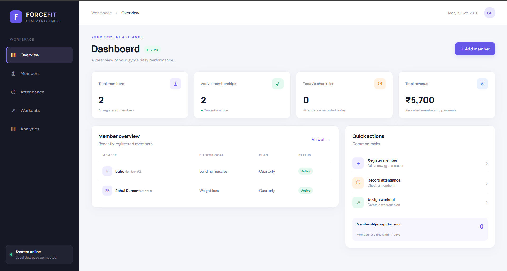
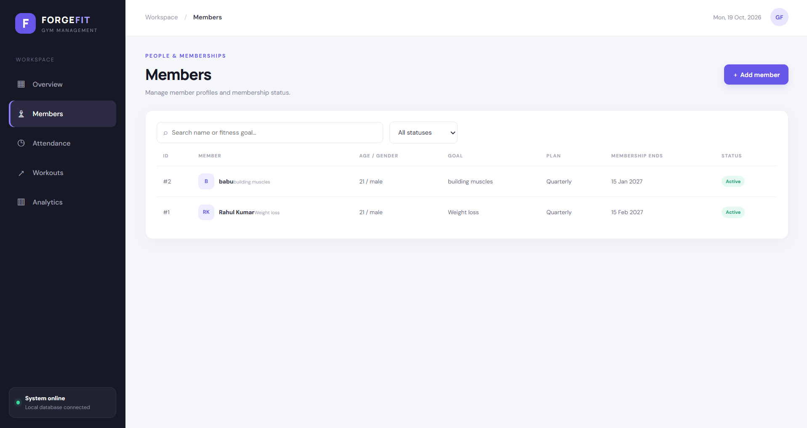
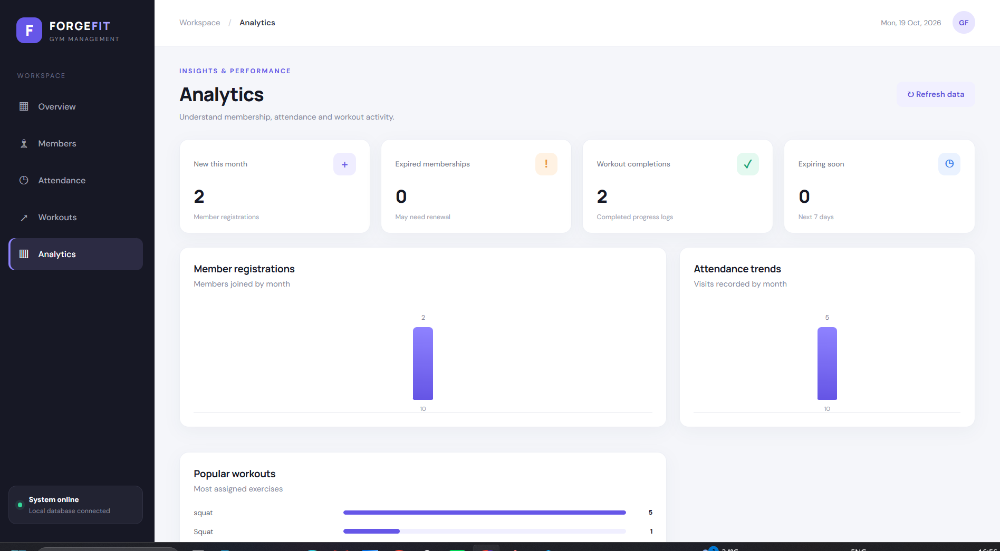

# 🏋️ ForgeFit – Gym Management & Fitness Analytics System

A Python-based gym management application built with Flask that helps manage gym members, track attendance, assign workouts, and analyze gym performance through data analytics.

## 📌 Project Overview

ForgeFit is a web-based gym management system designed to simplify everyday gym operations. It provides a dashboard for managing membership information, recording attendance, tracking workouts, and viewing analytics.

The application combines backend development with data analysis to demonstrate how software can help manage fitness facilities efficiently.

## ✨ Features

- **Dashboard:** View important gym statistics in one place.
- **Member Management:** Register, view, search, and update member information.
- **Membership Management:** Manage membership plans and renewals.
- **Attendance Tracking:** Record and monitor member attendance.
- **Workout Management:** Assign workouts and track workout progress.
- **Fitness Analytics:** Analyze gym data using Python data analysis libraries.
- **Data Visualization:** Generate charts to understand gym performance.
- **Database Integration:** Store application data using SQLite.
- **Web Interface:** Interact with the system through a dashboard built with HTML, CSS, and JavaScript.

## 🛠️ Technologies Used

| Technology | Purpose |
|---|---|
| Python | Backend programming |
| Flask | Web framework and API |
| SQLite | Database management |
| Pandas | Data analysis |
| NumPy | Numerical operations |
| Matplotlib | Data visualization |
| HTML | Web page structure |
| CSS | User interface styling |
| JavaScript | Frontend interactions |
| Git and GitHub | Version control and project hosting |

## 📂 Project Structure

```text
forgefit-gym-management/
│
├── analytics/
│   ├── __init__.py
│   ├── charts.py
│   └── generated/
│
├── data/
│   └── .gitkeep
│
├── models/
│   ├── __init__.py
│   └── database.py
│
├── services/
│   ├── __init__.py
│   └── gym_service.py
│
├── static/
│   ├── app.js
│   └── styles.css
│
├── templates/
│   └── index.html
│
├── tests/
│   └── README.md
│
├── screenshots/
├── app.py
├── requirements.txt
├── .gitignore
└── README.md
## Screenshots

### Dashboard


### Member Management


### Fitness Analytics
